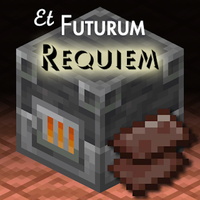

# Et Futurum Requiem

Backports features from modern Minecraft to 1.7.10 on top of the GTNH base.



**Download: [CurseForge](https://www.curseforge.com/minecraft/mc-mods/et-futurum-requiem/files)
| [Modrinth](https://modrinth.com/mod/etfuturum/versions)**

## Features

Backported features this build has which are not present in the GTNH branch:

* `/locate` command, and `/efrbuild <structurename>` to build any world gen structure added by the mod.
* Shields, including banner decoration.
* End cities, ships, elytra, dragon heads and more. Outer End islands generate with cities, and gateways generate once per dragon kill.
* Nether biomes generate and function as intended, though the default biome is still called hell and not nether wastes.
* Lightning rods, stonecutter, cartography table and loom. All the blocks that are decoration only in the GTNH branch have their expected GUIs, and the fletching table applies potions to arrows to make tipped arrows.
* Prismarine uses Botania's prismarine when Botania is loaded.
* Outside of the lower rock layer, ores and a few decorations, there is no overworld generation yet.

## Dependencies

The mod requires [UniMixins](https://modrinth.com/mod/unimixins), more specifically, the GTNH module.

## Building

```
./gradlew build
```

The buildscript takes the version from the latest git tag. Before the first tag, build with `VERSION=<ver> ./gradlew build`.

## Credits

* [KryptonCaptain](https://github.com/KryptonCaptain)'s Et Futurum build, and [jss2a98aj](https://github.com/jss2a98aj)'s fork of it.
* Roadhog360 (Roadhog460) for the HogUtils-era changes and the bubble column and tag work.
* makamys for mixin setup, the Iron Shulker Box container port, and the CI and nomixin scripts.
* embeddedt for the Backlytra port, spectator mode and the F3 gamemode switcher.
* The GTNH buildscript and [GTNewHorizons](https://github.com/GTNewHorizons).
* The mod uses MCLib's AssetDirector module to download assets from Mojang's servers. See [its wiki page](https://github.com/makamys/MCLib/wiki/AssetDirector).

## License

Et Futurum Requiem is licensed under the LGPL-3.0. A copy is in [`src/main/resources/LICENSE`](src/main/resources/LICENSE).

A lot of the code featured here is a direct copy or adaptation of Mojang's original code, so be careful with what you do with it.

## Contributing

To enable incomplete test features, add `-Detfuturum.testing=true` to your JVM arguments. This also enables a debug item

## Contributors
<a href="https://github.com/Roadhog360/Et-Futurum-Requiem/graphs/contributors">
  
</a>

*The below is legacy information and is only kept for documentation purposes.*

### About `nomixin` builds (Obsolete)

From versions 2.4.1 to 2.6.0, the mod came in two flavors:

* The regular version embeds Mixin 0.7.11, allowing the mod to run standalone. However, this makes the jar a bit larger,
  and can cause problems in certain use cases.
* The version marked with `nomixin` doesn't embed Mixin, which lets it avoid these problems. But it requires a
  separate [Mixin bootstrap mod](https://gist.github.com/makamys/7cb74cd71d93a4332d2891db2624e17c#mixin-bootstrap-mods)
  to be installed in order to run. If you have one installed already, getting this version is recommended.

From those versions, mixin code will also not work if you do not
add `--tweakClass org.spongepowered.asm.launch.MixinTweaker --mixin mixins.etfuturum.json` to your program arguments.
